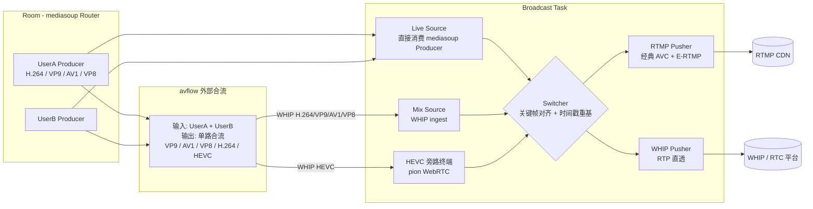
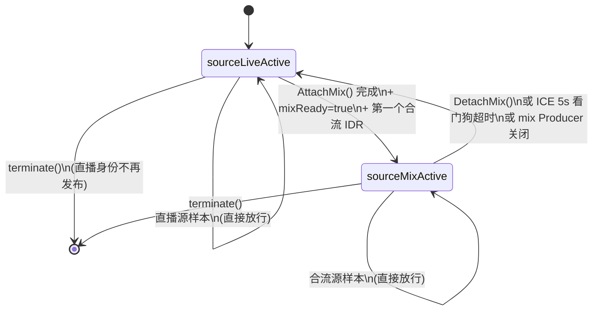
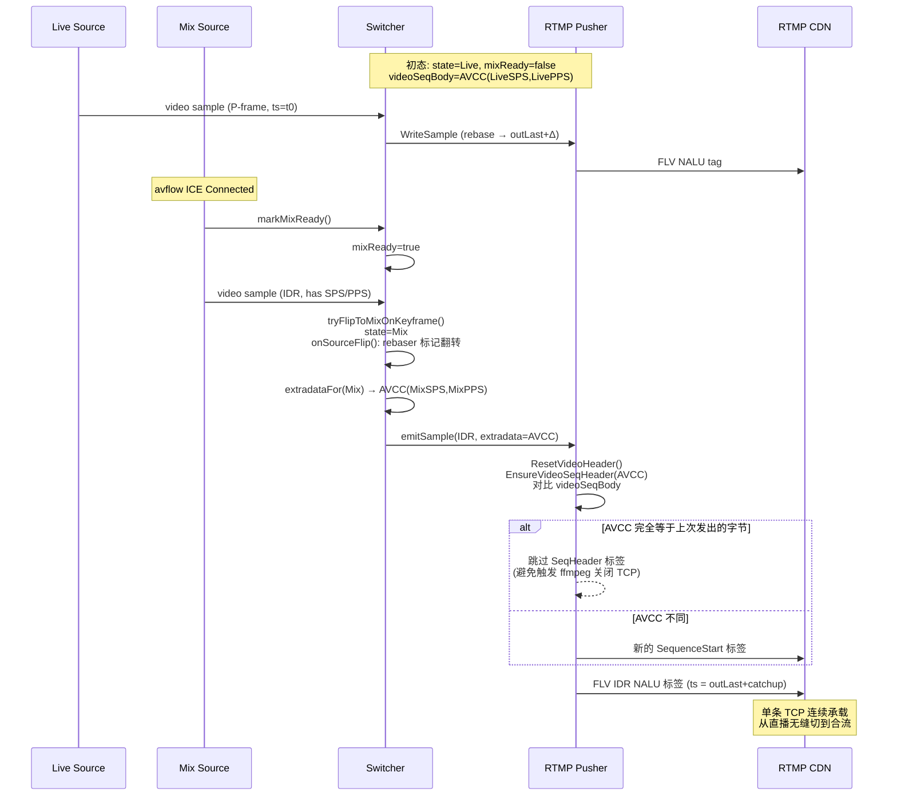
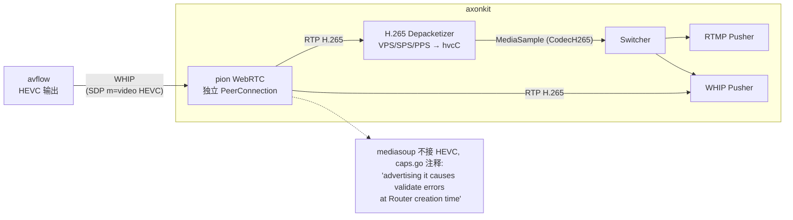

# 专利申请书：直播 / 连麦多源融合广播中无感切换与多编码兼容方法

## 背景

WebRTC SFU（如 mediasoup、livekit、janus）擅长低时延音视频转发，但其上游通道
是逐路 RTP，缺乏"将多路用户流合成单一直播流"的能力。常规做法是将房间里若干用
户的轨道送给一台外部合流服务（avflow、ffmpeg、Wirecast 等），再由合流端推 RTMP
到分发 CDN。

这一组合的痛点：

1. **直播 ↔ 连麦切换是一次"重连"**：从"主播单人直播"切到"两人连麦合流"通常
   需要断开旧的 RTMP 推流、重启合流任务、重新建立到 CDN 的 TCP 连接，CDN 端
   会丢一段播放、回看中也会断帧；反向切回亦然。
2. **合流端崩了直播就停了**：一旦合流服务的 ICE 失联或进程退出，下游 CDN 立
   刻收不到帧。
3. **新一代编码（VP9 / AV1 / HEVC）走 RTMP 受阻**：经典 FLV 视频 tag 只能放
   `CodecID` 低 4 位的几个老编码（AVC 是 7）。Enhanced-RTMP（以下简称 E-RTMP）
   定义了 FourCC 头但仍需要按编码路由不同的 SequenceStart payload。
4. **mediasoup 不支持 HEVC**：仅靠 SFU 内部，HEVC 流根本进不来；可生产 HEVC
   的合流服务（avflow）必须走另一条路径接入。

本发明解决上述问题：在同一条对外 RTMP / WHIP 推流通道上，**对接两类异构源**
（房间内 SFU 直推流、合流服务 WHIP 入流），**通过关键帧对齐 + 时间戳重基 +
配置记录字节级去重**实现无感切换、自动兜底，并在编解码层面统一路由 H.264 /
VP9 / AV1 / VP8 / HEVC 五种编码到正确的 E-RTMP / WHIP 出口：

- H.264 / VP9 / AV1 既可走经典 / E-RTMP 也可走 WHIP；
- VP8 在 SFU 与 WHIP 出口路径下完整可用，但**因 Enhanced-RTMP v2 标准未为
  VP8 注册 FourCC**，本系统在创建带有 RTMP 目标的广播任务时主动拒绝
  VP8 直播源，避免下游 RTMP 接收端解码失败；
- HEVC 因为 mediasoup 实现不支持其 RTP Capability，必须**单独走基于 pion
  的旁路 WebRTC 终结器**接入，再桥接到同一 Switcher / RTMP Pusher 管线，
  E-RTMP 出口侧使用 FourCC `hvc1` + `HEVCDecoderConfigurationRecord`。

---

## 发明内容

本发明提出一种**广播任务（Broadcast Task）**抽象与一种**双源切换装置
（Switcher）**：

- **广播任务**：以"房间 ID + 直播身份 ID + N 个推流目标 URL"为参数创建。任务
  内部固定一对外部出口（一组 RTMP pusher、一组 WHIP pusher），但内部源是可替
  换的；初始绑定**直播源（live source）**，可在运行期附加**合流源（mix source）**
  并由内部规则裁决哪一路驱动出口。
- **双源切换装置**：包含两个核心组件——
  1. **关键帧对齐切换器**，确保从直播切到合流的瞬间一定从合流的下一个 IDR /
     关键帧起跳，反向切回则向直播侧主动 PLI 请关键帧；
  2. **时间戳重基器（rebaser）**，将每路源的 RTP 时间戳重新映射到统一的输出
     时钟，源切换时强制施加一段"追赶刻度"以保证输出严格单调；
- **编解码无关 E-RTMP 路由层**：FourCC + SequenceStart 配置记录 + CodedFramesX
  按编码动态选择（H.264 / VP9 / AV1 / HEVC），并对配置记录进行字节级去重以
  避免中途 SeqHeader 触发 RTMP 服务端断开 TCP；
- **目标 ↔ 编码兼容性校验**：在广播任务 `Start()` 阶段一次性核对所选直播身
  份的视频编码与每个目标协议的兼容性，遇到 VP8 + RTMP 这类标准未覆盖的组合
  立刻报错返回，不允许进入媒体路径，从源头消除"运行期发现 FourCC 缺失"导
  致的下游回传错误；
- **HEVC 旁路 WHIP 入口**：对于 SFU 不支持的 HEVC 路径，使用基于 pion 的独立
  WebRTC 终结器消费 avflow 的 WHIP 推流，再把 RTP 桥接到同一套 Switcher /
  Pusher 管线。

---

## 附图说明

### 图 1：系统架构



ASCII 兜底：

```
   UserA, UserB Producers ─┐                    ┌─► RTMP CDN  (经典 AVC / E-RTMP)
                           ├─► Live Source ─┐   │
                           │                ├─► Switcher ─►┤
                           ├─► avflow 合流  │              │
                           │   └─► Mix WHIP ┘              └─► WHIP / RTC 平台
                           │       (mediasoup 终结)
                           └─► avflow HEVC ──► pion 旁路终端 ──► Switcher
```

### 图 2：Switcher 状态机



ASCII 兜底：

```
                ┌──────────────────────────────────────────────────────┐
                │                                                      │
   [start] ──► sourceLiveActive ──(mix IDR & ready)──► sourceMixActive │
                  ▲       ▲                                  │         │
                  │       │  ICE down 5s OR DetachMix       │         │
                  │       └──────────────────────────────────┘         │
                  │                                                    │
   live producer gone ─► terminate ◄── any state                       │
                                       └────────────────────────────────┘
```

### 图 3：直播 → 合流 单帧无感切换时序



ASCII 兜底：

```
Live  ─frame─►─frame─►─frame─►   (state=Live)
                                 ┌── markMixReady (ICE Connected) ──┐
Mix                              │                                  │
       (preroll, dropped)        ▼                                  ▼
                                IDR ──►  Switcher.flip()  ──►  Pusher
                                                                |
                                                       extradata 对比 →
                                                       同 → 不发 SeqHeader
                                                       异 → 发 SeqHeader
                                                                |
                                                    输出时钟 += catchup
                                                                |
                                                                ▼
                                                         RTMP CDN (单条 TCP)
```

### 图 4：编解码 → E-RTMP / WHIP 出口路由

```mermaid
flowchart TB
    subgraph In[输入编码]
        H264In[H.264]
        VP9In[VP9]
        AV1In[AV1]
        VP8In[VP8]
        HEVCIn[HEVC]
    end

    subgraph Path[出口路径]
        AVCFLV[经典 FLV 视频 tag\nFrameType<<4 \\| 0x07\nAVCDecoderConfigurationRecord]
        ERTMP9[E-RTMP\nFourCC=vp09\nVPCodecConfigurationRecord]
        ERTMP1[E-RTMP\nFourCC=av01\nAV1CodecConfigurationRecord]
        ERTMPH[E-RTMP\nFourCC=hvc1\nHEVCDecoderConfigurationRecord]
        REJECT[Start() 阶段拒绝\n"VP8 cannot be pushed to RTMP"]
        WHIPRP[WHIP RTP 直透]
    end

    H264In --> AVCFLV
    H264In --> WHIPRP
    VP9In --> ERTMP9
    VP9In --> WHIPRP
    AV1In --> ERTMP1
    AV1In --> WHIPRP
    VP8In --> REJECT
    VP8In --> WHIPRP
    HEVCIn --> ERTMPH
    HEVCIn --> WHIPRP
```

ASCII 兜底：

```
H.264 ─► FLV[CodecID=7]  (legacy AVC)              ┐
VP9   ─► E-RTMP FourCC "vp09" + vpcC               │ 经字节级去重 SeqHeader
AV1   ─► E-RTMP FourCC "av01" + AV1CC              │ 后发 CodedFramesX
HEVC  ─► E-RTMP FourCC "hvc1" + hvcC               ┘
VP8   ─► (RTMP destination 在 Broadcast.Start() 直接报错;
         Enhanced-RTMP v2 没有 VP8 FourCC)

任一编码 ─► WHIP egress = 原始 RTP 直透 (重基 timestamp)
                          (VP8 在 WHIP 出口完整可用)
```

### 图 5：HEVC 旁路 WHIP 入口



ASCII 兜底：

```
                  ┌──────────────────────────────────┐
                  │  axonkit                         │
                  │                                  │
   avflow HEVC ──►│  pion WHIP 终端 (旁路 mediasoup) │
                  │     │                            │
                  │     ├──► H.265 Depack ──► Switcher ──► RTMP / WHIP
                  │     └──► RTP 直透 ──────► WHIP egress
                  │                                  │
                  │  注: mediasoup-go 不支持 HEVC,    │
                  │  否则 Router.Validate 报错       │
                  └──────────────────────────────────┘
```

---

## 具体实施方式

### 模块 1：广播任务（Broadcast Task）抽象

广播任务接受请求 `POST /rtc/broadcast`：

```json
{
  "roomId": "...",
  "liveIdentity": "userA",
  "destinations": [
    {"protocol": "rtmp", "url": "rtmp://cdn1/live/k1"},
    {"protocol": "whip", "url": "https://rtc2/whip/foo"}
  ]
}
```

任务创建时：

1. 在 mediasoup Router 上为 `liveIdentity` 创建 `DirectTransport`，订阅其音频
   和视频 Producer，构造 `liveSource`；视频 Producer 必须协商出 H.264 / VP9 /
   AV1 / VP8 之一，否则报 `unsupported video codec`；HEVC 走旁路。
2. 为每个目标 URL 启动一个独立 pusher（`rtmpPusher` 或 `whipPusher`），各自
   后台 goroutine 维护连接，hot path 仅是 channel enqueue。
3. 创建并绑定 Switcher，初态 `sourceLiveActive`。

### 模块 2：Switcher 切换裁决

#### 2.1 状态机（图 2）

`switchState` 仅两状态：`sourceLiveActive` / `sourceMixActive`。变量
`mixReady` 是"合流源是否已经准备好接管"的旗标。

#### 2.2 关键帧对齐切换

**直播 → 合流**：

```go
// feedVideoSample 节选
case SourceMix:
    if !activeIsMix {
        if !mixReady || !sample.IsKeyFrame {
            return // 丢弃合流源所有非 IDR 帧, 等 IDR
        }
        if !s.tryFlipToMixOnKeyframe() {
            return
        }
    }
```

**合流 → 直播**：合流 ICE 持续断开 5 秒（`mixIceDisconnectGrace`）后由看门狗
触发 `flipToLive("mix ICE watchdog expired")`，同时调用
`liveSource.RequestKeyFrame()` 让 mediasoup 向直播身份回送 PLI，下一个
IDR 落地即生效。

#### 2.3 时间戳重基（rebaser）

每个 `(Kind, Path)` 维度独立持有一个 `rebaser`：

```go
type rebaser struct {
    hasBase        bool
    srcBase        uint32   // 当前源的本地基线
    outLast        uint32   // 上一个对外发出的输出时钟
    outInitialized bool
    catchup        uint32   // 切源时人为追赶的刻度
}

func (r *rebaser) rewrite(inTS uint32) uint32 {
    if !r.outInitialized { ... return 0 }
    if !r.hasBase { // 切源后第一个样本
        r.hasBase = true
        r.srcBase = inTS
        r.outLast += r.catchup     // 追赶: 音频 960, 视频 3000
        return r.outLast
    }
    delta := inTS - r.srcBase      // unsigned, 自然处理回绕
    out := r.outLast + delta
    if out < r.outLast {           // 单源内部回绕
        r.srcBase = inTS
        r.outLast += r.catchup
        return r.outLast
    }
    r.outLast = out
    r.srcBase = inTS
    return out
}
```

样本路径与裸 RTP 包路径**各自独立持有 rebaser**——前者发给 RTMP，后者发给
WHIP；如果共用，depack 之前的 RTP 已被改写过，进入 sample sink 又会被再改写
一次，导致 32 位下溢，输出 FLV 时间戳会变成几个小时（早期 verify-broadcast
真实踩到的 bug，故文中将"分桶 rebaser"列入权利要求）。

### 模块 3：编解码 SequenceStart 字节级去重

经典 RTMP receiver（含 ffmpeg flvenc）发现一条 TCP 上**第二次**出现
SequenceStart 标签会断连。我们在 pusher 内部维护：

```go
type rtmpPusher struct {
    videoSeqMu     sync.Mutex
    videoSeqBody   []byte // 上一次发出的 SeqHeader 字节
    videoSeqFourCC string // "" 表 AVC, 否则 E-RTMP FourCC
    videoHdrSent   atomic.Bool
}
```

切源时：

```go
p.ResetVideoHeader()                         // videoHdrSent = false
ok := p.EnsureVideoSeqHeader(newAVCC)        // 或 EnsureExVideoSeqHeader
// EnsureXxx 内部先 CompareAndSwap, 拿到锁再
// 字节比较 videoSeqBody == newAVCC, 相同则 return false 不入队.
```

效果：直播身份和 avflow 合流如果使用**完全相同的 SPS/PPS**（同分辨率、同
profile、相同 SEI 订阅），切换时不会有任何 SeqHeader 出现在 TCP 上，下游
ffmpeg 无感继续录制。

> 该思路同样适用于 VP9 vpcC、AV1 av1C、HEVC hvcC、VP8 vpcC——只要源切换前后
> 配置记录字节级一致就跳发。

### 模块 4：编解码无关 E-RTMP 路由

```go
func (p *rtmpPusher) WriteSample(s MediaSample) {
    var body []byte
    switch s.Codec {
    case CodecH264:
        body = buildAVCFrameTag(s.IsKeyFrame, s.Data)
    case CodecVP9:
        body = buildExVideoFrameTag(flvExVideoFourCCVP9, s.IsKeyFrame, s.Data)
    case CodecAV1:
        body = buildExVideoFrameTag(flvExVideoFourCCAV1, s.IsKeyFrame, s.Data)
    case CodecH265:
        body = buildExVideoFrameTag(flvExVideoFourCCH265, s.IsKeyFrame, s.Data)
    case CodecOpus:
        body = buildOpusFrameTag(s.Data)
    default:
        // VP8 落入 default: validateDestinationsForCodec 已在
        // Broadcast.Start 阶段拒绝带 RTMP 目标的 VP8 直播源, 此处
        // 兜底丢弃以防未来有人新增 RTMP 目标却忘了对应 FourCC.
        return
    }
    p.enqueue(...)
}
```

```go
// validateDestinationsForCodec: 仅在 Start() 阶段执行一次, 不在 hot path
// 内做检查. 任一目标为 RTMP 且直播源编码为 VP8 时, 立即返回错误.
func validateDestinationsForCodec(dsts []Destination, videoCodec Codec) error {
    if videoCodec != CodecVP8 {
        return nil
    }
    for _, d := range dsts {
        if d.Type == DestinationRTMP {
            return fmt.Errorf("broadcast: VP8 cannot be pushed to RTMP" +
                " destinations (Enhanced-RTMP v2 has no FourCC for VP8);" +
                " use a WHIP destination or republish in H.264/VP9/AV1")
        }
    }
    return nil
}
```

SequenceStart 配置记录：

| 编码 | RTMP 出口 | FourCC | 记录类型 | 来源 |
|------|-----------|--------|---------|------|
| H.264 | ✅ | (legacy)`avc1`/0x07 | AVCDecoderConfigurationRecord (avcC) | depack 收到 SPS+PPS |
| VP9 | ✅ | `vp09` | VPCodecConfigurationRecord (vpcC) | depack 解码 uncompressed header |
| AV1 | ✅ | `av01` | AV1CodecConfigurationRecord (av1C) | depack 抓取 Sequence Header OBU |
| VP8 | ❌ Start() 拒绝 | — | — (Enhanced-RTMP v2 未注册) | WHIP 出口侧由 RTP 直透 |
| HEVC | ✅ | `hvc1` | HEVCDecoderConfigurationRecord (hvcC) | depack 收到 VPS+SPS+PPS |

### 模块 5：HEVC 旁路 WHIP 终端（图 5）

mediasoup-go 的 `supportedRtpCapabilities` 表没有 HEVC，**无法**在 Router 上
注册 `video/H265` Capability，否则 Router 创建直接报错。但 avflow 完全可以输
出 HEVC over WHIP。本发明的解法：

1. `POST /rtc/broadcast/{id}/whip` 收到 SDP Offer 时，`offerNeedsH265Bypass`
   先做轻量分类：
   - 若 `m=video` 段只含 H.264 / VP9 / AV1 / VP8（或 H.264+H.265 混编） →
     走 mediasoup `WebRtcTransport` + `Producer` 的常规路径；
   - 若 `m=video` 段**只含** H.265 → `attachMixH265Bypass` 启动一条独立的
     pion `webrtc.PeerConnection`，注册 H.265+Opus 编解码能力，
     SetRemoteDescription / CreateAnswer / SetLocalDescription，等待 ICE
     完成。
2. pion 侧 `OnTrack` 触发后，每个 remote track 起一条 RTP 读循环：每个 RTP
   包同时投喂 `H265Depacketizer`（出口 RTMP 用）与 `packetSink`（出口 WHIP
   用），与 mediasoup 路径完全同形。
3. 两条路径对外**实现同一个 `mixIngress` 接口**（`Close` / `VideoDepack` /
   `RestartIce`），Broadcast / Switcher 不区分下层实现，一个 `videoDepacketizer`
   的对象就足够。
4. 生命周期对齐：`OnICEConnectionStateChange` 的 `disconnected` / `failed`
   触发 5 秒看门狗，超时即 `flipToLive`；`closed` / `PeerConnection failed`
   立刻触发同样的回切。所有动作复用 `Broadcast.handleMixGone`，与 mediasoup
   路径走同一段代码。
5. RTMP 出口仍走模块 4 的 `EnsureExVideoSeqHeader("hvc1", hvcC)` 路径，与
   H.264 / VP9 / AV1 完全对称——SFU 内部是否能承载该编码与 RTMP 出口能力
   解耦。

#### 5.1 关键代码位置

```
pkg/broadcast/depack_h265.go      // H.265 NAL 拼装 + hvcC 生成
pkg/broadcast/source_mix_h265.go  // 旁路 pion WHIP 终端 + offerNeedsH265Bypass
pkg/broadcast/broadcast.go        // attachMixH265Bypass 分派；mixIngress 抽象
pkg/broadcast/source_mix.go       // mediasoup 路径仍是默认；实现 mixIngress
pkg/broadcast/flv.go              // buildExVideoH265Tag / buildHEVCConfigRecord
pkg/broadcast/rtmp_pusher.go      // WriteSample: case CodecH265
pkg/broadcast/sample.go           // CodecH265 enum, IsVideo() 包含
```

---

## 权利要求

1. 一种基于 SFU 的直播任务系统，其特征在于：所述系统包含一个广播任务对象，
   广播任务对象同时拥有：（a）一个由 SFU 直接消费房间内指定身份 Producer 的
   **直播源**；（b）至少一个可在运行期附加 / 卸载的 **合流源**，其媒体来自
   一个外部合流服务通过 WHIP 协议推送至本系统的 ingest 端点；（c）N 个对外
   推流目标，所述目标在源切换过程中保持单一长 TCP / WHIP 会话，不重连。

2. 根据权利要求 1 所述的系统，其特征在于：所述广播任务包含一个**关键帧对齐
   切换器**，所述切换器在收到合流源的第一个视频关键帧之前持续把直播源样本
   发往出口推流器，并在该关键帧到达后的同一调用栈内原子地将后续样本切换为
   合流源样本，避免出口推流器观察到非 IDR 起跳的 GOP。

3. 根据权利要求 2 所述的系统，其特征在于：所述切换器为每路出口分别为音频
   样本、视频样本、音频原始 RTP、视频原始 RTP 维护四个独立的时间戳重基器，
   每个重基器记录上一发出的输出时钟与当前源的源端基线，源切换时强制施加一
   段追赶刻度，使得任一出口侧观察到的时间戳序列在源切换前后严格非递减且不
   回绕。

4. 根据权利要求 3 所述的系统，其特征在于：所述追赶刻度的取值与对应媒体的
   常规帧间隔一致，音频选取一帧时长（如 Opus 20 ms = 960 在 48 kHz 时钟），
   视频选取一帧时长（如 30 fps = 3000 在 90 kHz 时钟）。

5. 根据权利要求 1 所述的系统，其特征在于：所述广播任务包含一个 **ICE 看门
   狗**，看门狗监听合流源的 ICE 连接状态，当 ICE 状态进入断开持续超过预设
   宽限期（如 5 秒）时，触发自动回切到直播源，并向直播源发起 PLI 请求新的
   关键帧；当合流源的 mediasoup Producer 关闭事件先于看门狗到达时，立即
   触发上述回切。

6. 根据权利要求 5 所述的系统，其特征在于：当回切的瞬间，所述切换器同时为
   音频与视频两类时间戳重基器进入"切源"状态，使得回切后第一个直播源样本对
   应的输出时间戳在原输出时钟上至少前进一个所述追赶刻度。

7. 一种异构编码下的 RTMP / Enhanced-RTMP 推流方法，其特征在于：所述方法对
   外保持单一长 TCP 推流连接，对内根据样本编码类型动态选择 FLV 视频 tag 的
   字节布局：对 H.264 采用经典 `(FrameType << 4) | CodecID=7` 一字节头加
   AVCC 接入单元；对 VP9 / AV1 / HEVC 采用 Enhanced-RTMP 扩展头
   `IsExHeader=1 + FrameType + PacketType` 加 4 字节 FourCC（依次为 `vp09` /
   `av01` / `hvc1`）加各自的配置记录或编码帧字节；对 VP8 因 Enhanced-RTMP v2
   尚未注册 FourCC，方法在广播任务启动阶段对"VP8 + 至少一个 RTMP 目标"组合
   进行一次性兼容性校验并直接拒绝，避免在 hot path 上动态降级或下游解码失败。

8. 根据权利要求 7 所述的方法，其特征在于：所述推流方法在每条 RTMP 连接上
   维护"上一次发出的视频 SequenceStart 字节"缓存，当切源动作发生时，先取消
   "已发标志"，并对新源的配置记录进行字节级比较：完全相同则不再入队
   SequenceStart 标签，继续直接发送编码帧标签；不同则先入队新的
   SequenceStart 标签再继续，从而避免 RTMP 接收端因一条 TCP 上重复见到
   SequenceStart 而主动断开。

9. 根据权利要求 7 所述的方法，其特征在于：所述配置记录分别由对应的
   depacketizer 在接收到关键帧时构造，VP9 由 VPCodecConfigurationRecord 描
   述，AV1 由 AV1CodecConfigurationRecord 描述（包含 Sequence Header OBU），
   HEVC 由 HEVCDecoderConfigurationRecord 描述（包含 VPS / SPS / PPS），
   H.264 由 AVCDecoderConfigurationRecord 描述；VP8 在 SFU 侧由
   VP8Depacketizer 完成 RTP→帧重装并在 WHIP 出口路径上直透 RTP，但不参与
   E-RTMP 配置记录构造。

10. 根据权利要求 1 所述的系统，其特征在于：所述广播任务在合流源 ingest 端点
    处对 SDP Offer 进行编码探测：若仅含 SFU 已注册支持的编码，则路由至基于
    SFU 的 WHIP 终结路径；若含有 SFU 未注册支持的编码（如 HEVC），则路由
    至独立的 WebRTC 终结路径，所述终结路径直接拥有 PeerConnection 与
    RTP 处理逻辑，绕过 SFU；两条路径终结后均向同一关键帧对齐切换器投递
    MediaSample 与 RTP 包，使得上层切换、重基、推流逻辑对底层 ingest 实现
    完全无感。

11. 根据权利要求 10 所述的系统，其特征在于：所述独立 WebRTC 终结路径执行
    与 SFU 路径相同的 ICE 看门狗、Producer 关闭探测，所述探测结果同样可
    触发权利要求 5 所述的自动回切。

12. 一种计算机可读存储介质，其上存储有指令，所述指令被处理器执行时实现
    权利要求 1 至 11 任一项所述的系统或方法。

---

## 说明书附图列表

- 图 1（系统架构）：见上文 Mermaid 块 + ASCII 兜底。
- 图 2（Switcher 状态机）：见上文 Mermaid 块。
- 图 3（直播 → 合流 单帧无感切换时序）：见上文 Mermaid 块。
- 图 4（编解码 → E-RTMP / WHIP 出口路由）：见上文 Mermaid 块。
- 图 5（HEVC 旁路 WHIP 入口）：见上文 Mermaid 块。

---

## 与现有技术对比

| 维度 | 传统方案 | 本发明 |
|------|----------|--------|
| 直播 ↔ 连麦切换 | 重建 RTMP TCP，CDN 见到一次断流 | 单条 TCP，配置记录字节级去重，下游无感 |
| 切换时机 | 任意时间点 cut，下游解码出花屏 | 等合流 IDR 到达再切，回切则向直播 PLI |
| 时间戳 | 切换后跳变可能负向 | 双源独立 rebaser + 强制追赶刻度，严格单调 |
| 合流端崩溃 | 直播端口持续无帧 | ICE 看门狗 5 秒回切到直播源 |
| 多编码 | 仅 H.264 走 RTMP；VP9/AV1/HEVC 需另起 WebRTC 通道 | 同一 RTMP 连接 + Enhanced-RTMP，按编码动态选 FourCC |
| HEVC 入口 | mediasoup 无法承载 | 旁路 pion 终结，复用同一切换器 / 推流器 |

---

## 实施现状对照（截至 2026-04）

| 模块 | 文件 | 状态 |
|------|------|------|
| Broadcast Task | `pkg/broadcast/broadcast.go`, `manager.go` | 已实现 |
| 目标 ↔ 编码兼容性校验（VP8 + RTMP 拒绝） | `pkg/broadcast/broadcast.go::validateDestinationsForCodec` | 已实现 |
| Live Source | `pkg/broadcast/source_live.go` | 已实现（H.264 / VP9 / AV1 / VP8） |
| Mix Source（mediasoup 路径） | `pkg/broadcast/source_mix.go` | 已实现（H.264 / VP9 / AV1 / VP8） |
| Switcher + Rebaser | `pkg/broadcast/switcher.go` | 已实现 |
| RTMP Pusher + 字节级去重 | `pkg/broadcast/rtmp_pusher.go` | 已实现 |
| WHIP Pusher | `pkg/broadcast/whip_pusher.go` | 已实现 |
| H.264 Depack + avcC | `pkg/broadcast/depack_h264.go` | 已实现 |
| VP9 Depack + vpcC | `pkg/broadcast/depack_vp9.go` | 已实现 |
| AV1 Depack + av1C | `pkg/broadcast/depack_av1.go` | 已实现 |
| VP8 Depack（仅 SFU 侧 / WHIP 出口） | `pkg/broadcast/depack_vp8.go` | 已实现 |
| H.265 Depack + hvcC（出口侧） | `pkg/broadcast/depack_h265.go`, `pkg/broadcast/flv.go::buildHEVCConfigRecord` | 已实现 |
| H.265 RTMP 路由（FourCC `hvc1`） | `pkg/broadcast/rtmp_pusher.go`, `pkg/broadcast/pusher.go` | 已实现 |
| H.265 旁路 WHIP 终结（pion 直接 PeerConnection） | `pkg/broadcast/source_mix_h265.go`, `pkg/broadcast/broadcast.go::attachMixH265Bypass` | 已实现（offer SDP 仅含 H.265 时自动路由到 pion 旁路；OnTrack→H265Depacketizer→Switcher；ICE 看门狗与 mediasoup 路径同源） |
| 端到端验证 | `test/broadcast/verify.sh`, `test/broadcast/verify-avflow.sh` | 已实现（H.264 / VP9 / AV1）；VP8 / HEVC 待补 WHIP 出口验证目标 |
