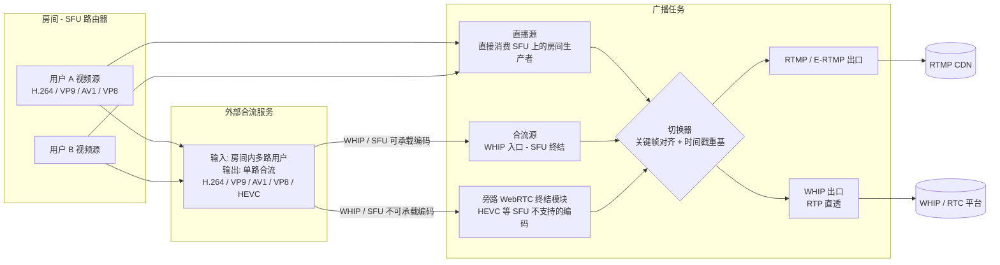
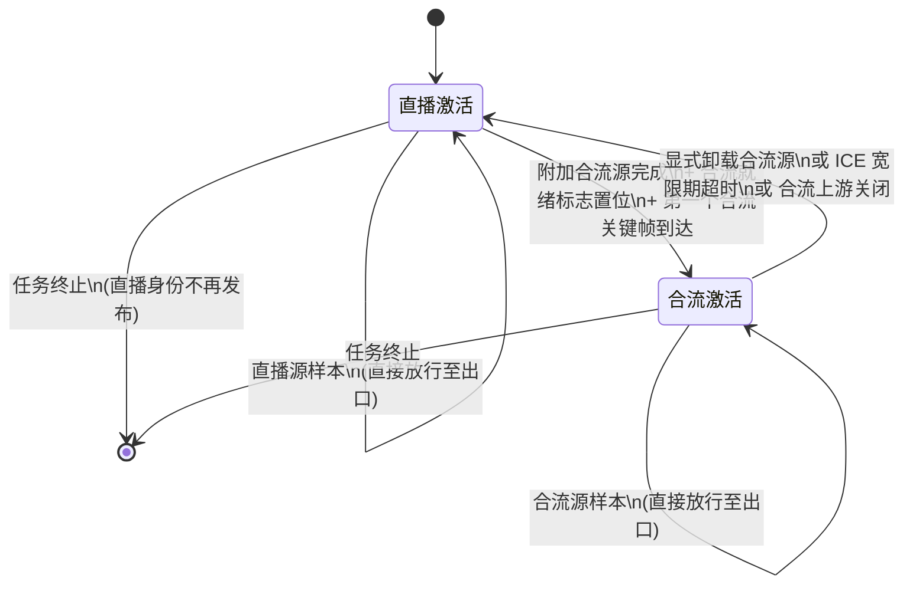
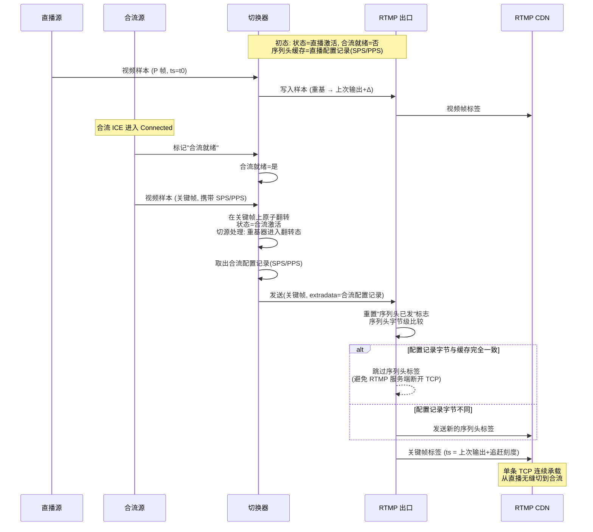
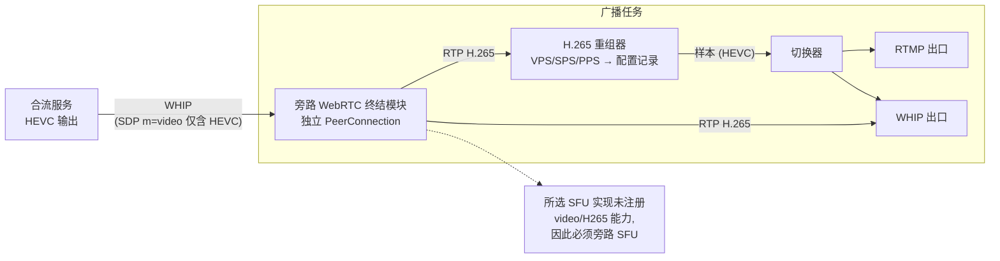

# 专利申请书：直播 / 连麦多源融合广播中无感切换与多编码兼容方法

## 背景

WebRTC 选择性转发单元（Selective Forwarding Unit，下文简称 SFU）擅长低时延音
视频转发，但其上游通道是逐路 RTP 流，缺乏"将多路用户媒体合成单一直播流"的能
力。常规做法是把房间内若干用户的轨道送给一台外部合流服务，再由合流端推 RTMP
到分发 CDN。

这一组合存在以下普遍痛点：

1. **直播 ↔ 连麦切换是一次"重连"**：从"主播单人直播"切到"两人连麦合流"通
   常需要断开旧的 RTMP 推流、重启合流任务、重新建立到 CDN 的 TCP 连接，CDN 端
   会丢一段播放、回看也会断帧；反向切回亦然。
2. **合流端故障即直播停播**：一旦合流服务的 ICE 失联或进程退出，下游 CDN 立
   刻收不到帧，缺乏统一的兜底机制。
3. **新一代视频编码走 RTMP 受阻**：经典 FLV 视频 tag 的 `CodecID` 字段只能编
   码 H.264 等少数老编码。Enhanced-RTMP（下文简称 E-RTMP）规范引入了 FourCC
   扩展头，但每种编码仍需要按其 RTP 净荷格式构造对应的 SequenceStart 配置记
   录与 CodedFrames 帧体，缺一不可。
4. **部分 SFU 实现不接受 HEVC**：典型开源 SFU 的可生产能力表中并未注册 HEVC
   的 RTP Capability，导致带有 HEVC 的 Producer 根本无法在 SFU 内成立；而能产
   出 HEVC 的合流服务（外部混流器）必须借助一条独立路径才能接入。

本发明针对上述痛点，在同一条对外推流通道上，**对接两类异构源**——房间内
SFU 直推流（下文简称"直播源"）与合流服务通过 WHIP 协议入流（下文简称"合
流源"），**通过关键帧对齐、时间戳重基、配置记录字节级去重**实现源切换在出
口推流连接上不可感知；并在编解码层面统一路由 H.264 / VP9 / AV1 / VP8 / HEVC
五种编码到合适的出口形态：

- H.264 / VP9 / AV1 既可走经典 / 增强 RTMP 也可走 WHIP；
- VP8 在 SFU 与 WHIP 出口路径下完整可用，但**因 Enhanced-RTMP v2 标准未为
  VP8 注册 FourCC**，本系统在创建带有 RTMP 目标的广播任务时主动拒绝 VP8 直
  播源，避免下游 RTMP 接收端解码失败；
- HEVC 因部分 SFU 实现未注册其 RTP Capability，必须**单独走基于独立 WebRTC
  终结模块的旁路入口**接入，再桥接到同一切换 / 推流管线，E-RTMP 出口侧使
  用 FourCC `hvc1` + HEVCDecoderConfigurationRecord。

---

## 发明内容

本发明提出一种**广播任务（Broadcast Task）抽象**与一种**双源切换装置
（Switcher）**：

- **广播任务**：以"房间标识 + 直播身份标识 + N 个推流目标地址"为输入参数
  创建。任务内部固定一组对外出口（一组 RTMP 出口、一组 WHIP 出口），但内部
  源是可替换的；初始绑定**直播源**，可在运行期附加 / 卸载**合流源**，并由
  内部规则裁决哪一路驱动出口。
- **双源切换装置**包含两个核心子模块：
  1. **关键帧对齐切换器**：确保从直播切到合流的瞬间一定从合流的下一个
     IDR / 关键帧起跳；反向切回则向直播侧主动请求关键帧。
  2. **时间戳重基器**：将每路源的 RTP 时间戳重新映射到统一的输出时钟；源
     切换时强制施加一段"追赶刻度"以保证输出时钟严格单调且不回绕。
- **编解码无关 E-RTMP 路由层**：FourCC + SequenceStart 配置记录 +
  CodedFrames 按编码动态选择（H.264 / VP9 / AV1 / HEVC），并对每路出口缓存
  "上次发出的配置记录字节"，源切换前后做字节级比较以避免触发 RTMP 服务端
  断开 TCP。
- **目标 ↔ 编码兼容性校验**：在广播任务启动阶段一次性核对所选直播身份的
  视频编码与每个出口协议的兼容性，遇到 VP8 + RTMP 这类规范未覆盖的组合立
  刻拒绝，不允许进入媒体路径，从源头消除"运行期发现 FourCC 缺失"导致的下
  游回传错误。
- **旁路 WebRTC 终结路径**：合流入口对 SDP Offer 进行编码探测，若 Offer 中
  的视频编码超出当前 SFU 的可注册能力（如 HEVC），系统切换到**独立的
  WebRTC 终结模块**直接终结 DTLS / SRTP，将解出的 RTP 接入同一关键帧对齐切
  换器与重基器；上层完全不感知下层 ingest 走的是 SFU 还是旁路。

---

## 附图说明

### 图 1：系统架构



ASCII 兜底：

```
   房间内多路用户生产者 ─┐                    ┌─► RTMP CDN  (经典 / 增强 RTMP)
                         ├─► 直播源 ─┐        │
                         │           ├─► 切换器 ─►┤
                         ├─► 合流服务 │           │
                         │   └─► 合流源 (SFU 终结)└─► WHIP / RTC 平台
                         │
                         └─► 合流服务 ──► 旁路 WebRTC 终结 ──► 切换器
                              (HEVC 等编码)
```

### 图 2：切换器状态机



ASCII 兜底：

```
                ┌──────────────────────────────────────────────────────┐
                │                                                      │
   [开始] ──► 直播激活 ──(合流关键帧 & 就绪)──► 合流激活                │
                  ▲       ▲                          │                 │
                  │       │ ICE 持续断开 ≥ 宽限期      │                 │
                  │       │ 或显式卸载合流             │                 │
                  │       └──────────────────────────┘                 │
                  │                                                    │
   直播上游关闭 ─► 任务终止 ◄── 任意状态                                  │
                                       └────────────────────────────────┘
```

### 图 3：直播 → 合流 单帧无感切换时序



ASCII 兜底：

```
直播  ─帧─►─帧─►─帧─►   (状态=直播激活)
                                 ┌── 合流标记就绪 (ICE Connected) ──┐
合流                              │                                  │
       (前置帧, 全部丢弃)           ▼                                  ▼
                                关键帧 ──►  切换器原子翻转  ──►  出口模块
                                                                │
                                                       配置记录字节比较 →
                                                       同 → 不发序列头
                                                       异 → 发新序列头
                                                                │
                                                    输出时钟 += 追赶刻度
                                                                │
                                                                ▼
                                                         RTMP CDN (单条 TCP)
```

### 图 4：编解码 → E-RTMP / WHIP 出口路由

```mermaid
flowchart TB
    subgraph In[输入编码]
        H264In[H.264]
        VP9In[VP9]
        AV1In[AV1]
        VP8In[VP8]
        HEVCIn[HEVC]
    end

    subgraph Path[出口路径]
        AVCFLV[经典 FLV 视频标签\nFrameType<<4 \\| CodecID=AVC\nAVC 配置记录]
        ERTMP9[E-RTMP\nFourCC=vp09\nVP 配置记录]
        ERTMP1[E-RTMP\nFourCC=av01\nAV1 配置记录]
        ERTMPH[E-RTMP\nFourCC=hvc1\nHEVC 配置记录]
        REJECT[启动阶段拒绝\n"VP8 不可推往 RTMP 目标"]
        WHIPRP[WHIP 出口\nRTP 直透]
    end

    H264In --> AVCFLV
    H264In --> WHIPRP
    VP9In --> ERTMP9
    VP9In --> WHIPRP
    AV1In --> ERTMP1
    AV1In --> WHIPRP
    VP8In --> REJECT
    VP8In --> WHIPRP
    HEVCIn --> ERTMPH
    HEVCIn --> WHIPRP
```

ASCII 兜底：

```
H.264 ─► 经典 FLV (CodecID=AVC)                      ┐
VP9   ─► E-RTMP FourCC "vp09" + VP 配置记录           │ 配置记录字节级去重
AV1   ─► E-RTMP FourCC "av01" + AV1 配置记录          │ 后再发编码帧标签
HEVC  ─► E-RTMP FourCC "hvc1" + HEVC 配置记录         ┘
VP8   ─► (启动阶段拒绝带 RTMP 目标的广播任务;
         Enhanced-RTMP v2 未为 VP8 分配 FourCC)

任一编码 ─► WHIP 出口 = 原始 RTP 直透 (重基时间戳)
                          (VP8 在 WHIP 出口完整可用)
```

### 图 5：旁路 WebRTC 终结路径（以 HEVC 为例）



ASCII 兜底：

```
                  ┌──────────────────────────────────┐
                  │  广播任务                         │
                  │                                  │
   合流 HEVC  ──►│  旁路 WebRTC 终结 (绕过 SFU)      │
                  │     │                            │
                  │     ├──► H.265 重组 ──► 切换器 ──► RTMP / WHIP
                  │     └──► RTP 直透 ──────► WHIP 出口
                  │                                  │
                  │  注: 当前 SFU 实现不接受 HEVC,    │
                  │  否则路由器创建即报错             │
                  └──────────────────────────────────┘
```

---

## 具体实施方式

### 模块 1：广播任务抽象

广播任务由控制面接口接收以下参数创建：房间标识、直播身份标识、N 个推流目标
（每个目标包含协议类型与目的地址）。在某些实施例中，N 上限取小整数（例如 3）
以保证出口侧资源可控。

任务创建过程包括：

1. 在 SFU 路由器上为指定的直播身份建立媒体消费通路，订阅其音频与视频上游产
   生者，得到**直播源**对象。视频上游必须协商出本系统支持的编码（H.264 /
   VP9 / AV1 / VP8）之一；超出 SFU 可注册能力的编码（HEVC）由旁路终结路径
   处理（见模块 6），不在直播源中出现。
2. 为每个推流目标启动一个独立的出口模块（RTMP 或 WHIP），各自后台维护连接
   状态与字节计数；上层 hot path 仅进行入队，不阻塞媒体处理线程。
3. 创建并绑定切换器，初始状态为"直播激活"。
4. 执行**目标 ↔ 编码兼容性校验**（见模块 5）。校验失败立即拒绝任务创建，
   不进入媒体路径。

### 模块 2：双源切换装置

#### 2.1 状态机（图 2）

切换器内部仅维护两个状态：**直播激活**与**合流激活**，外加一个布尔旗标
"合流就绪"。"合流就绪"由合流入口在 ICE 进入 Connected 且第一个合流视频
关键帧到达时置位。

#### 2.2 关键帧对齐切换

直播 → 合流：当切换器收到合流路径上的视频样本时，按以下规则裁决：

```
若 状态 == 直播激活:
    若 合流就绪 == 否 或 当前样本不是关键帧:
        丢弃该样本, 直接 return
    否则:
        在该样本上原子地把 状态 改为 合流激活
        发出该关键帧及其后续合流样本
```

合流 → 直播：在两种触发源下回切——

- **合流 ICE 看门狗超时**：合流入口的 ICE 状态进入 Disconnected / Failed 后，
  若持续超过预设宽限期（典型值 5 秒）仍未恢复，看门狗强制翻转为直播激活，
  并向直播源发起关键帧请求（PLI），下一个直播 IDR 落地即生效；
- **合流上游关闭**：合流的上游生产者关闭事件先于看门狗到达时（典型场景：
  显式 `DELETE` 合流入口资源），切换器立即翻转。

#### 2.3 时间戳重基器

每个 `(媒体类型, 路径)` 维度独立持有一个**时间戳重基器**，用以下抽象状态
与算法描述：

```
重基器内部状态:
    源端基线: uint32        // 当前源的最近输入时间戳
    输出最近: uint32        // 上一次对外发出的输出时间戳
    输出已初始化: bool
    源已初始化: bool
    追赶刻度: uint32        // 切源时人为前进的刻度

重基算法 rewrite(当前输入时间戳):
    若 输出未初始化:                       // 第一帧
        输出最近 = 0
        输出已初始化 = 是
        return 0
    若 源未初始化:                         // 切源后第一帧
        源端基线 = 当前输入
        源已初始化 = 是
        输出最近 += 追赶刻度               // 强制前进
        return 输出最近
    Δ = 当前输入 - 源端基线              // 无符号减法, 自然处理回绕
    输出 = 输出最近 + Δ
    若 输出 < 输出最近:                    // 单源内部回绕
        源端基线 = 当前输入
        输出最近 += 追赶刻度
        return 输出最近
    输出最近 = 输出
    源端基线 = 当前输入
    return 输出
```

切源时，控制面调用重基器的"翻转"动作，将"源已初始化"重置为否，使得下
一个该路径上的样本在 `rewrite` 函数中走进"切源后第一帧"分支，从而强制
施加追赶刻度。

#### 2.4 分桶重基的必要性

样本路径（去包后送 RTMP 出口）与裸 RTP 包路径（直透到 WHIP 出口）在切换器
内部各自持有独立的重基器实例，因为：

- 样本路径的时间戳是去包后的访问单元时间戳，已经经过 depacketizer 一次处
  理；
- 裸 RTP 包路径直接使用 RTP 包头里的 32 位时间戳。

两条路径若共用一个重基器，去包之前的 RTP 已被改写，进入样本路径又会被再
改写一次，导致 32 位下溢，输出时间戳跳变成数小时之远。因此本发明强调"分
桶重基器"是单独的权利要求要素。

### 模块 3：配置记录字节级去重

经典 RTMP 接收端实现（含某些 FLV 录制器与转封装器）发现单条 TCP 连接上
**第二次**出现同种类的 SequenceStart 配置记录会立即关闭连接，因为它把这
当作"流参数变更"信号。本发明在每个 RTMP / E-RTMP 出口模块内部维护以下抽
象状态：

- "上一次发出的视频配置记录"字节缓存；
- "上一次的 FourCC 标签"（空串代表经典 H.264，否则为 vp09 / av01 / hvc1
  之一）；
- "序列头已发出"原子标志。

切换器在每次源翻转时，对所有出口模块调用"重置序列头"动作，将"已发出"
原子标志清零；下一帧到达时，出口模块按以下流程发送序列头：

```
EnsureSeqHeader(新配置记录, 新 FourCC):
    使用 CompareAndSwap 抢占"已发出"标志, 抢占失败直接 return
    取互斥锁:
        若 字节缓存 与 新配置记录 完全相同 且 FourCC 相同:
            什么也不发, return false      // 关键去重点
        否则:
            字节缓存 = 新配置记录
            FourCC 缓存 = 新 FourCC
            生成 SequenceStart FLV 标签并入队
            return true
```

**效果**：在直播身份与合流任务的视频参数（分辨率、Profile、SPS/PPS、SEI 等）
完全相同时，源切换不会产生任何序列头标签出现在 TCP 上，下游录制器不会感
知到切换；参数不同则只触发**一次**新序列头，下游正常切换解码上下文。

### 模块 4：编解码无关 E-RTMP 路由

每个 RTMP / E-RTMP 出口模块对每个输入样本，按下表选取 FLV 视频标签的字节
布局：

| 输入编码 | RTMP 出口 | FLV 标签布局 | FourCC | 配置记录类型 | 来源 |
|----------|-----------|--------------|--------|--------------|------|
| H.264    | 支持      | 经典：FrameType + CodecID(AVC) | — | AVCDecoderConfigurationRecord | depacketizer 缓存 SPS+PPS |
| VP9      | 支持      | E-RTMP：IsExHeader=1 + FrameType + PacketType + FourCC + 帧体 | `vp09` | VPCodecConfigurationRecord | depacketizer 解码 uncompressed header |
| AV1      | 支持      | E-RTMP                       | `av01` | AV1CodecConfigurationRecord | depacketizer 抓取 Sequence Header OBU |
| HEVC     | 支持      | E-RTMP                       | `hvc1` | HEVCDecoderConfigurationRecord | depacketizer 缓存 VPS+SPS+PPS |
| VP8      | **拒绝**  | —                           | — | — (Enhanced-RTMP v2 未注册) | 启动阶段拒绝（见模块 5） |

WHIP 出口对所有支持的编码（含 VP8）均以原始 RTP 直透方式工作，仅做时间戳
重基与 SSRC / 序列号改写，不做任何编码层重组。

### 模块 5：目标 ↔ 编码兼容性校验

广播任务在启动阶段，对解析出的直播源视频编码与全部出口目标做一次性兼容
性校验：

```
ValidateDestinationsForCodec(目标列表, 视频编码):
    若 视频编码 != VP8:
        return 通过
    遍历 目标列表:
        若 目标协议 == RTMP:
            return 拒绝, 错误信息: "VP8 不可推往 RTMP 目标
              (Enhanced-RTMP v2 未为 VP8 分配 FourCC);
              请改用 WHIP 目标或重转码为 H.264 / VP9 / AV1"
    return 通过
```

校验**只在任务启动一次**，不在媒体 hot path 上重复检查；校验通过后，"启
动失败"与"媒体路径运行期失败"被严格区分，控制面错误响应一目了然。

### 模块 6：旁路 WebRTC 终结路径

部分 SFU 实现的可生产能力表中并未注册某些视频编码（典型场景为开源 SFU 不
支持 HEVC）。本发明的解法：

1. **入口编码探测**：合流入口收到 SDP Offer 后，先扫描每个 m=video 段的
   rtpmap 列表（剔除 RTX / RED / FEC 等辅助条目），按以下规则决定路由：
   - 若所有视频 m 段提供的"主编码"都在 SFU 已注册集合内（H.264 / VP9 /
     AV1 / VP8），或 Offer 中至少有一个 SFU 可承载的视频编码与 SFU 不支持
     的编码并存（这种 Offer 中 SFU 可成功协商出可承载的那一种）→ 走**SFU
     路径**；
   - 若所有视频 m 段提供的主编码均**只有** SFU 未注册的编码（如 HEVC）
     → 走**旁路 WebRTC 终结路径**。
2. **旁路终结模块**：构造一个独立的 WebRTC PeerConnection 实例，注册目标
   编码（如 HEVC）与 Opus 的编解码能力，以及标准的 RTCP 反馈处理；
   Set Remote Description → Create Answer → Set Local Description → 等待
   ICE 候选收集完成；将得到的 Answer SDP 与 ICE 用户名作为 WHIP 资源 ETag
   返回给入口客户端。
3. **远端轨道接管**：旁路终结模块的"远端轨道到达"事件触发后，对每条轨道
   起一条 RTP 读循环：每个 RTP 包同时投递到——
   - 该编码的 RTP 重组器，得到访问单元样本送入切换器（驱动 RTMP 出口）；
   - 切换器的 RTP 包通道，原始 RTP 直透到 WHIP 出口。
4. **生命周期对齐**：旁路终结模块同样实现"合流入口"接口，对外暴露与
   SFU 路径完全一致的方法集（关闭、获取视频重组器、ICE 重启）；ICE 状态
   `disconnected` / `failed` 触发与 SFU 路径**同一段**看门狗逻辑（见模
   块 2.2）；PeerConnection 整体进入 Failed / Closed 状态时立即触发"合流
   消失"回调，复用直播兜底。
5. **出口对称**：旁路终结路径的样本进入切换器与重基器后，与 SFU 路径完全
   等价；E-RTMP 出口对 HEVC 样本走与 H.264 / VP9 / AV1 同形的 SeqHeader 字
   节级去重逻辑，FourCC 选用 `hvc1`，配置记录为 HEVCDecoderConfigurationRecord。

**关键意义**：通过把"合流入口"抽象为接口（而非绑定具体的 SFU 终结实现），
SFU 是否能承载某种编码与广播任务是否能用该编码作为合流源**完全解耦**。
任何未来发布的新视频编码，只要在旁路 WebRTC 库中可终结，就能立即在本系
统中作为合流源使用，无须等待 SFU 升级。

---

## 权利要求

1. 一种基于 SFU 的直播任务系统，其特征在于：所述系统包含一个广播任务对象，
   广播任务对象同时拥有：（a）一个由 SFU 直接消费房间内指定身份生产者的
   **直播源**；（b）至少一个可在运行期附加 / 卸载的**合流源**，其媒体来自
   一个外部合流服务通过 WHIP 协议推送至本系统的 ingest 端点；（c）N 个对外
   推流目标，所述目标在源切换过程中保持单一长 TCP / WHIP 会话，不重连。

2. 根据权利要求 1 所述的系统，其特征在于：所述广播任务包含一个**关键帧对
   齐切换器**，所述切换器在收到合流源的第一个视频关键帧之前持续把直播源样
   本发往出口推流器，并在该关键帧到达后的同一调用栈内原子地将后续样本切换
   为合流源样本，避免出口推流器观察到非 IDR 起跳的 GOP。

3. 根据权利要求 2 所述的系统，其特征在于：所述切换器为每路出口分别为音频
   样本、视频样本、音频原始 RTP、视频原始 RTP 维护四个独立的时间戳重基器；
   每个重基器记录上一发出的输出时钟与当前源的源端基线，源切换时强制施加一
   段追赶刻度，使得任一出口侧观察到的时间戳序列在源切换前后严格非递减且不
   回绕。

4. 根据权利要求 3 所述的系统，其特征在于：所述追赶刻度的取值与对应媒体的
   常规帧间隔一致，音频选取一帧时长（如 Opus 20 ms 在 48 kHz 时钟下为
   960），视频选取一帧时长（如 30 fps 在 90 kHz 时钟下为 3000）。

5. 根据权利要求 1 所述的系统，其特征在于：所述广播任务包含一个 **ICE 看门
   狗**，看门狗监听合流源的 ICE 连接状态；当 ICE 状态进入断开持续超过预设
   宽限期（如 5 秒）时，触发自动回切到直播源，并向直播源发起关键帧请求；
   当合流源上游媒体生产者的关闭事件先于看门狗到达时，立即触发上述回切。

6. 根据权利要求 5 所述的系统，其特征在于：当回切的瞬间，所述切换器同时为
   音频与视频两类时间戳重基器进入"切源"状态，使得回切后第一个直播源样
   本对应的输出时间戳在原输出时钟上至少前进一个所述追赶刻度。

7. 一种异构编码下的 RTMP / Enhanced-RTMP 推流方法，其特征在于：所述方法
   对外保持单一长 TCP 推流连接，对内根据样本编码类型动态选择 FLV 视频标
   签的字节布局：对 H.264 采用经典"FrameType + CodecID(AVC)"一字节头加
   AVC 配置记录；对 VP9 / AV1 / HEVC 采用 Enhanced-RTMP 扩展头
   "IsExHeader=1 + FrameType + PacketType"加 4 字节 FourCC（依次为
   `vp09` / `av01` / `hvc1`）加各自的配置记录或编码帧字节；对 VP8 因
   Enhanced-RTMP v2 尚未注册 FourCC，方法在广播任务启动阶段对"VP8 + 至
   少一个 RTMP 目标"组合进行一次性兼容性校验并直接拒绝，避免在媒体处
   理路径上动态降级或下游解码失败。

8. 根据权利要求 7 所述的方法，其特征在于：所述推流方法在每条 RTMP 连接
   上维护"上一次发出的视频配置记录字节缓存"，当切源动作发生时，先取消
   "已发出"标志，并对新源的配置记录进行字节级比较：完全相同则不再入队
   SequenceStart 标签，继续直接发送编码帧标签；不同则先入队新的
   SequenceStart 标签再继续，从而避免 RTMP 接收端因一条 TCP 上重复见到
   SequenceStart 而主动断开。

9. 根据权利要求 7 所述的方法，其特征在于：所述配置记录分别由对应编码的
   RTP 重组器在接收到关键帧时构造，VP9 由 VPCodecConfigurationRecord 描
   述，AV1 由 AV1CodecConfigurationRecord 描述（包含 Sequence Header
   OBU），HEVC 由 HEVCDecoderConfigurationRecord 描述（包含 VPS / SPS /
   PPS），H.264 由 AVCDecoderConfigurationRecord 描述；VP8 在 SFU 侧由
   独立的 RTP 重组器完成 RTP→帧重装并在 WHIP 出口路径上直透 RTP，但不
   参与 E-RTMP 配置记录构造。

10. 根据权利要求 1 所述的系统，其特征在于：所述广播任务在合流源 ingest
    端点处对 SDP Offer 进行编码探测：若 Offer 中所有视频 m 段提供的主编
    码均位于当前 SFU 已注册的可承载编码集合内，则路由至基于 SFU 的 WHIP
    终结路径；若 Offer 中所有视频 m 段提供的主编码均**仅含**当前 SFU 未
    注册的编码，则路由至独立的 WebRTC 终结路径，所述终结路径直接拥有
    PeerConnection 与 RTP 处理逻辑，绕过 SFU；两条路径均向同一关键帧对
    齐切换器投递媒体样本与原始 RTP 包，使得上层切换、重基、推流逻辑对底
    层 ingest 实现完全无感。

11. 根据权利要求 10 所述的系统，其特征在于：所述独立 WebRTC 终结路径与
    SFU 路径对外暴露同一组接口（包括关闭、暴露视频配置记录、ICE 重启）；
    所述独立路径执行与 SFU 路径**完全相同的** ICE 看门狗与上游关闭探
    测，所述探测结果同样可触发权利要求 5 所述的自动回切。

12. 一种计算机可读存储介质，其上存储有指令，所述指令被处理器执行时实现
    权利要求 1 至 11 任一项所述的系统或方法。

---

## 说明书附图列表

- 图 1（系统架构）：见上文 Mermaid 块及 ASCII 兜底。
- 图 2（切换器状态机）：见上文 Mermaid 块及 ASCII 兜底。
- 图 3（直播 → 合流 单帧无感切换时序）：见上文 Mermaid 块及 ASCII 兜底。
- 图 4（编解码 → E-RTMP / WHIP 出口路由）：见上文 Mermaid 块及 ASCII 兜底。
- 图 5（旁路 WebRTC 终结路径）：见上文 Mermaid 块及 ASCII 兜底。

---

## 与现有技术对比

| 维度 | 传统方案 | 本发明 |
|------|----------|--------|
| 直播 ↔ 连麦切换 | 重建 RTMP TCP，CDN 见到一次断流 | 单条 TCP，配置记录字节级去重，下游无感 |
| 切换时机 | 任意时间点 cut，下游解码出花屏 | 等合流关键帧到达再切，回切则向直播请求关键帧 |
| 时间戳 | 切换后跳变可能负向 | 双源独立重基器 + 强制追赶刻度，严格单调 |
| 合流端崩溃 | 直播端口持续无帧 | ICE 看门狗超时回切到直播源 |
| 多编码 | 仅 H.264 走 RTMP；VP9/AV1/HEVC 需另起 WebRTC 通道 | 同一 RTMP 连接 + Enhanced-RTMP，按编码动态选 FourCC；VP8 在启动阶段拒绝以避免下游错误 |
| HEVC 入口 | SFU 不接受 HEVC 即彻底无解 | 旁路独立 WebRTC 终结，复用同一切换器 / 推流器 |
| 兼容性校验 | 运行期发现编码 / 协议不匹配 | 启动阶段一次性校验并拒绝不可承载组合 |
